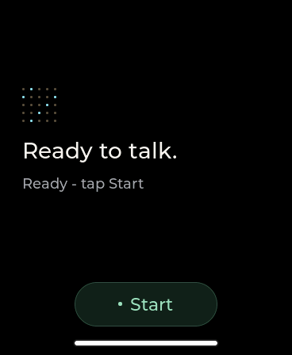
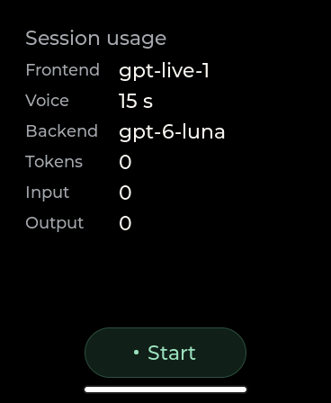

# OpenAI Live SDK for ESP32

> **Experimental project. Not officially supported by OpenAI.** This is a proof
> of concept, with no stability guarantees or support commitment.

Build a voice assistant with the [OpenAI Live API](https://developers.openai.com/api/docs/guides/live)
on an ESP32-S3. The project has two parts:

1. **Core SDK:** a portable C protocol library and an ESP-IDF WebRTC/Opus adapter.
2. **Device examples:** a native Live Voice app for the **Waveshare
   ESP32-S3-Touch-AMOLED-1.8 V2**, integrated into its Brookesia launcher, a
   standalone app for **M5Stack CoreS3 LITE**, and a screenless **Sonatino**
   headset example.

A separate [experimental portable WebRTC package](packages/peer) provides a
libpeer-derived C transport, host interoperability tests, and a security review.
It is independently buildable and supplies all three examples' WebRTC transport.

## Waveshare screenshots

These are unmodified framebuffer captures from the app running on a physical
Waveshare device, not mockups. The Dot rail layout hides the launcher's status
bar to give captions more room. See [capture details](docs/screenshots/README.md).

| Ready | Caption layout during a Live session | Session usage |
| --- | --- | --- |
|  |  |  |

## Core SDK

| Component | Purpose |
| --- | --- |
| [`components/live`](components/live) | Portable C API for session creation, JSON offer/answer, events, mute, and graceful close. Depends on cJSON; has no board or credential storage. |
| [`components/live_esp32`](components/live_esp32) | ESP-IDF adapter: HTTPS signaling, portable peer connection, Opus audio, transcript buffers, usage accounting, and startup timing. |
| [`components/live_peer`](components/live_peer) | ESP-IDF build and platform integration for the source-built WebRTC transport in `packages/peer`. |
| [`examples/protocol_smoke`](examples/protocol_smoke) | Hardware-independent ESP32-S3 protocol test firmware for QEMU and esp-emu. |

Start with the [core integration guide](docs/core.md) and
[`live.h`](components/live/include/live.h). Board applications provide Wi-Fi and
audio callbacks. The portable library can also be used with another transport
implementation.

The SDK uses the public Live WebRTC JSON offer/answer protocol at
`POST https://api.openai.com/v1/live/sessions`. RTP carries audio; a reliable data
channel carries JSON events. This is the Live API, whose signaling and event
contract differs from the Realtime API.

## Waveshare example app

[`examples/waveshare`](examples/waveshare) targets the **V2 CO5300 display** board
with 16 MB flash, 8 MB PSRAM, touch input, microphone, and ES8311 audio codec.
It provides:

- One Start/Stop button whose color reflects connection state.
- Compact cyan user captions and warm sand assistant captions with a dotted turn rail.
- A session-end page with model names, voice duration, and backend token usage.
- Saved Wi-Fi profiles and automatic fallback when a network is unavailable.
- Responses delegation with `gpt-6-luna`, priority tier, and hosted web search.
- USB controls for diagnostics, timing, and actual device screenshots.
- A [USB screen mirror](examples/waveshare/README.md#usb-screen-mirror-and-demo-recording)
  with a laptop viewer and screen-only video recording.

The example uses `gpt-live-1` for voice. Model availability and API usage charges
depend on your account. Model names can be configured at build time.

**[Build, configure, and flash the Waveshare app →](examples/waveshare/README.md)**

## M5Stack example app

[`examples/m5stack`](examples/m5stack) adapts the same SDK to the **CoreS3 LITE**:
a 320 × 240 touch UI, ES7210 microphones, AW88298 speaker, saved Wi-Fi profiles,
colored paginated captions, and session usage. Its board drivers and build are
separate from Waveshare; the protocol, WebRTC, Opus, and playback buffering are
shared. See the [build and flash guide](examples/m5stack/README.md).

## Sonatino example app

[`examples/sonatino`](examples/sonatino) runs the shared stack on the **Sonatino
revision 3.1.x** audio board with a CTIA headset. USB commands provide session
control, volume, transcript snapshots, and diagnostics. It has no screen or
launcher. See the [hardware setup and build guide](examples/sonatino/README.md).

The device examples embed your API key and Wi-Fi credentials in locally built
firmware. Provision them outside this checkout. **Never publish that firmware,
its build directory, flash backups, or credential files.** See
[credential handling](SECURITY.md). No credentials or prebuilt firmware are
included in this repository.

## Build and test the core

Install [ESP-IDF 5.5.2](https://docs.espressif.com/projects/esp-idf/en/v5.5.2/esp32s3/get-started/index.html),
including its ESP32-S3 tools, and activate its `export.sh`. The documented command
line workflow targets macOS/Linux. From this repository:

```sh
cmake -S . -B build-host -G Ninja -DCMAKE_BUILD_TYPE=Debug
cmake --build build-host
ctest --test-dir build-host --output-on-failure
python -m unittest discover -s tests -p 'test_*.py'
```

Native tests cover protocol parsing and lifecycle, Wi-Fi selection, transcript
buffering, PCM priming, usage snapshots, response deduplication, and TLS cache lifecycle. They use synthetic
fixtures, need no API key, and enable ASan/UBSan by default. Use
`-DLIVE_SANITIZE=OFF` if your compiler lacks those runtimes.

To run the portable protocol tests as ESP32-S3 firmware:

```sh
idf.py -C examples/protocol_smoke set-target esp32s3 build merge-bin
python tools/run_emulator.py qemu
python tools/run_emulator.py esp-emu
```

Install the desired emulator first; see [testing and emulation](docs/testing.md).
Emulator tests cover protocol/runtime behavior, not the board's microphone,
speaker, display, Wi-Fi reliability, or a complete voice call.

## Current limits

This is an early SDK. A bounded 120 ms playback reserve absorbs short arrival
delays; it is not an adaptive jitter buffer. There is no acoustic echo
cancellation or packet-loss concealment in the example. Audio quality and
interruptions need further tuning.
The named Waveshare V2 and M5Stack CoreS3 LITE boards have been exercised end to
end. Other boards need their own audio/display integration.

The portable core supports creation, mute, close, and raw event forwarding.
It does not yet provide typed APIs for arbitrary tools, session updates, or
client-delegation completion. Payload and buffer limits are documented in the
[core guide](docs/core.md). Reconnection creates a new session.

Live reports voice usage in seconds, not frontend token counts. Backend tokens
come from delegated Responses events. After an interrupted connection, the last
received snapshot may omit in-flight usage. See the public
[usage guide](https://developers.openai.com/api/docs/guides/voice-latency-cost#monitor-actual-usage).

## License and contributions

Original SDK/example code and locally maintained portable transport changes are
provided under the [Apache License 2.0](LICENSE). See [NOTICE](NOTICE) for
attribution.
The portable WebRTC package retains libpeer's MIT attribution and uses separately
licensed cryptographic and SCTP dependencies. The caption font retains the SIL
Open Font License. The Waveshare firmware also downloads device libraries with
Espressif-only terms, including its audio codec; those terms do not apply to the
standalone portable transport. See [third-party notices](THIRD_PARTY_NOTICES.md)
for the dependency inventory, license exceptions, and upstream sources.

Issues and pull requests are welcome, but support and response times are not
guaranteed. Include your board revision, ESP-IDF version, reproduction steps,
and sanitized logs. Do not include API keys, Wi-Fi credentials, private
conversations, or firmware images.
